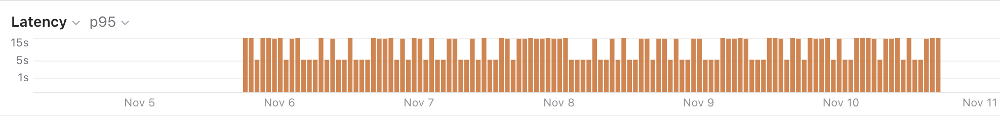
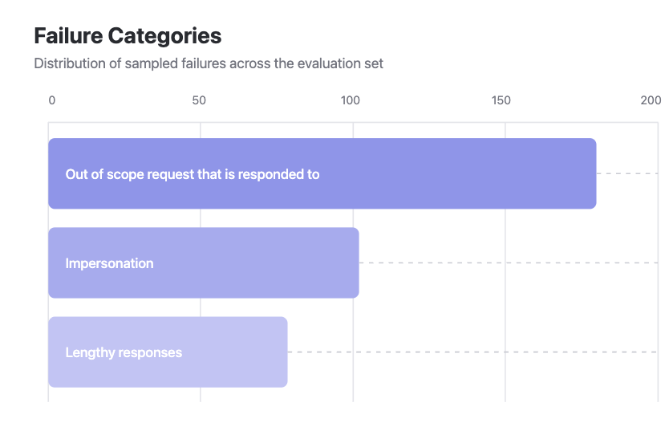
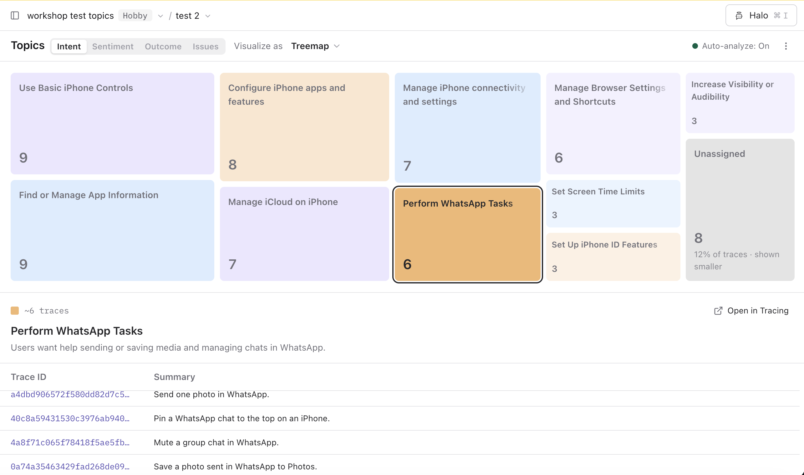
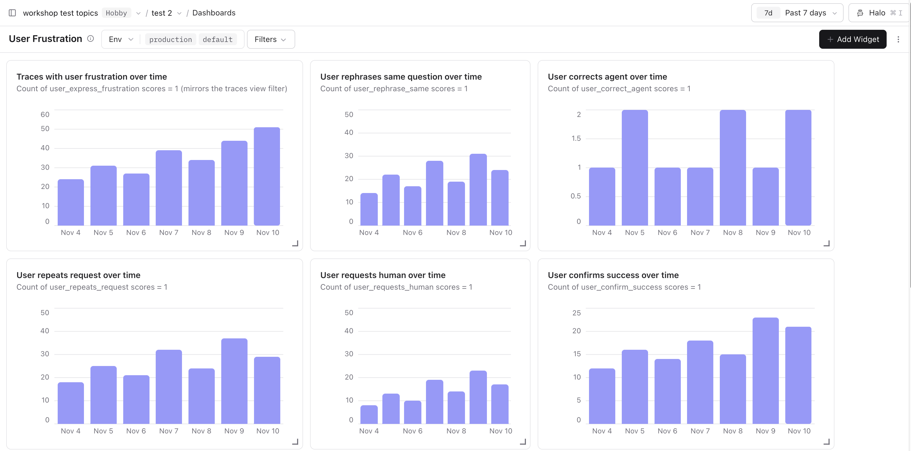

# 04 Monitoring

## Why we monitor

Tracing gives you a record of every step your agent takes. As soon as the system is in production or faces larger scale testing, the volume grows quickly to a point where reviewing every trace one by one and deriving patterns is no longer feasible.

Monitoring is how you look at that tracing data at scale. It covers aggregate metrics and trends over time, approaches to derive failure modes, and it covers signals that pick out individual executions worth a closer look.

## Ways to work with production traces

There are a few different ways to work with production data at scale.

### Look at cost, latency, and quality

Cost and latency are logged on every trace. With [dashboards](https://langfuse.com/docs/metrics/features/custom-dashboards) you can build out a view on aggregate metrics over time, like spend per model, most used tool calls, and tools that are most likely to fail.

### Do structured error analysis

Error analysis is a structured approach to identify failure modes in your application. Error analysis is run by humans, often domain experts, and is a process that is worth repeating as the application is evolving.

The Academy page on [error analysis](https://langfuse.com/academy/monitoring/error-analysis) goes deeper into how to run this approach.

In the hands-on lab in [section 4.1 Error analysis](./04-monitoring/error-analysis.md), we run through error analysis for the Dad IT Support Agent together.

### Identify topics and issues at scale

Error analysis derives general concepts from individual traces, and a person does that reading. Topics and issue detection is the scaled and automated approach: it clusters incoming traces into intent, sentiment, outcome, and issue categories. That shows the current state of the system, and how that state changes over time.

In the hands-on lab in [section 4.2 Detect topics and issues](./04-monitoring/topics.md), we run through topics and issue detection for the Dad IT Support Agent together.

### Capture signals from users

A signal is something the user does or says that indicates how the turn felt, stored on the trace as a score. It is a judgment from the moment of use.

Chat agents benefit from capturing signals. Any agent that interacts with a person can attach signals of success, completion, or problems as scores on its traces.

For Specs, we start with two conversation signals. We identify whether Dad disagrees with the steps, and whether Dad is writing in all caps. Both are strong signs that the last answer failed, or at least that the conversation is worth looking into.

The Academy page on [capturing signals](https://langfuse.com/academy/monitoring/capturing-signals) maps explicit ratings, behavioral signals, conversation signals, and outcomes.

In the hands-on lab in [section 4.3 Capturing signals](./04-monitoring/capturing-signals.md), we run through capturing signals for the Dad IT Support Agent together.
