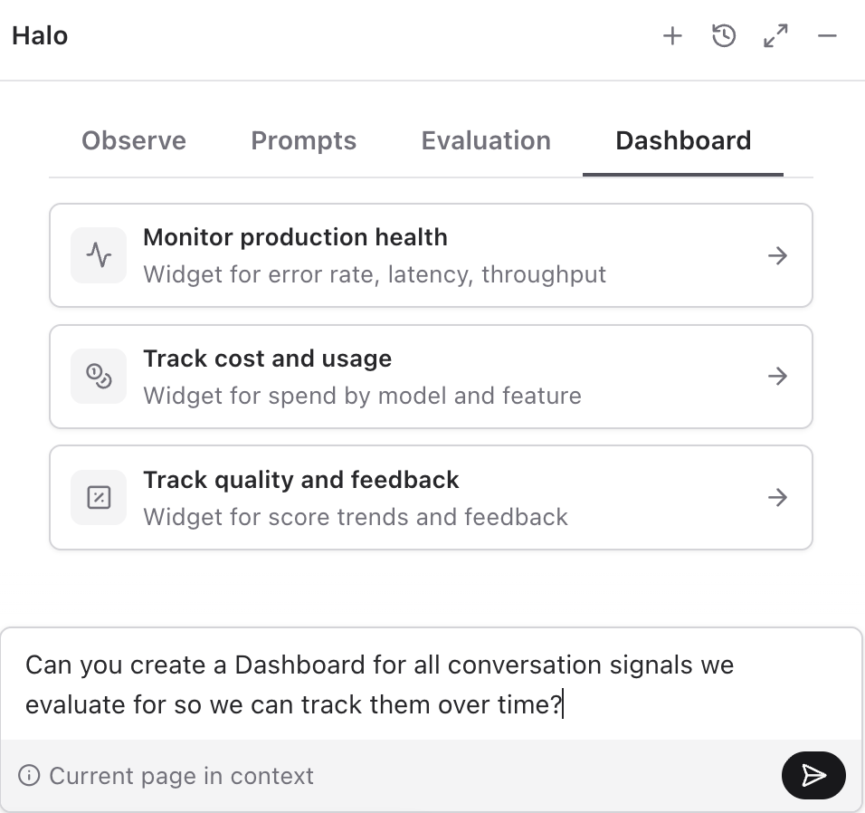
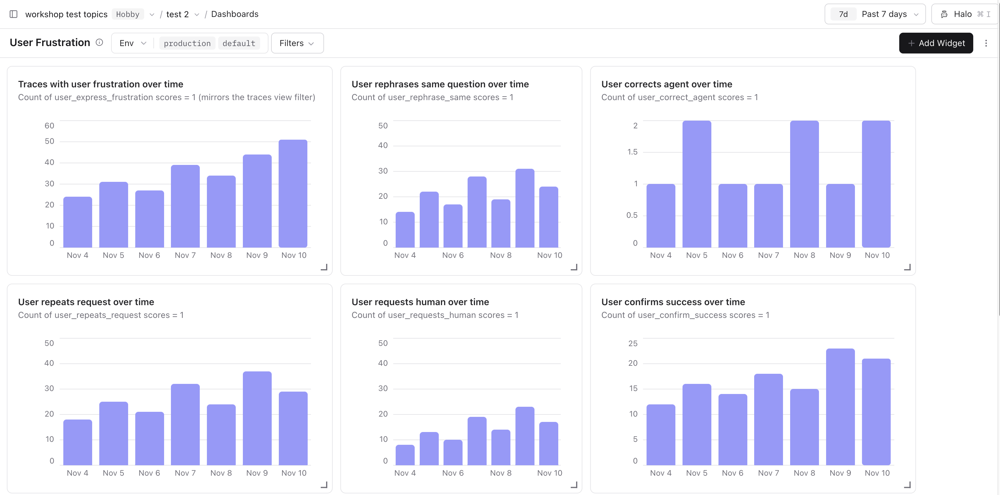

# 4.2 Capturing signals

## Why capture signals

Once traces are coming in, you want a judgment on them without opening each one. A production signal is something the user does or says that shows whether a turn went well: a correction, a retry, a request for a human, a thank-you. Stored as a score on the trace, it points you to the rows worth reading. Start with the negative ones: a user rarely corrects an answer they were happy with.

Complementary materials:

- Docs: [Evaluate production traffic](https://langfuse.com/docs/evaluation/get-started/online)
- Academy: [Capturing signals](https://langfuse.com/academy/monitoring/capturing-signals)

## Starting point

```bash
git checkout checkpoint/04-monitoring
```

## Goal

Capture two conversation signals for Specs, so you can find these turns without opening every trace:

- **User disagreement:** Dad pushes back ("No, that menu isn't there"). Either the agent gave the wrong steps or the app is showing its limits.
- **All-caps frustration:** Dad writes something like "THIS STILL ISNT WORKING". A long run of capital letters is a cheap deterministic clue that the conversation may need extra attention. It is a triage hint, not proof that Dad is angry.

## Step 0: Set up the evaluator model

The disagreement judge needs a model connection on the project. The keys in `.env` do not fill that list.

1. In Langfuse, open **Project Settings → LLM Connections**.
2. Click **Add LLM Connection**.
3. Choose OpenAI, name the connection, and paste your OpenAI API key into the secret field.
4. Save the connection.

If a connection is already there, keep it and continue.

Keep the API key in the Langfuse secret field only. Do not paste it into workshop transcripts or shared notes.

When the evaluator wizard in Step 1 asks you to pick a model, choose this connection and **5.6 Luna** (`gpt-5.6-luna`).


## Step 1: Wire the judge-based monitor (Langfuse UI)

Langfuse ships a published **Detect User Disagreement** template. It is an LLM-as-a-judge evaluator that reads variables from observations.

**Detect User Disagreement** maps `{{conversation_history}}` to every input message and `{{last_user_message}}` to the last input message. Target the root `dad-it-support-chat-turn` agent observation.

Pick **Detect User Disagreement** for the mapping in this step.

1. In Langfuse, open **Evaluators → New Evaluator** and pick **Detect User Disagreement** from the **Template Gallery**.
2. On the right side, select the trace root as a sample observation. Filter to the `production` environment if the panel is showing something else. We are targeting the root observation of type Agent, the place where the overall trace input and output is logged. **Hint**: If you hover over the filters in the filter bar, you will see what each of those filter out. You can also 'Ask AI' to configure your filters.

   

3. Under **Map variables to data**, bind each variable from the live observation tree. Open a row, hover the field, and press **Use**. Do not use **Type a JSONPath instead**.

   - `{{conversation_history}}`: open **Input**, hover **messages**, and press **Use**. The binding reads **Input → messages** (every message).
   - `{{last_user_message}}`: open **Input → messages**, hover **last**, and press **Use**. The binding reads **Input → messages → last**.

   

   

4. In the right panel, you can test run your evaluator on a sample observation.

   

5. Finally click on **Create evaluator**. In the upcoming screen you can see a rough cost estimation per week and set a sampling rate. As soon as you click on execute, your first evaluator is running.

   

The rule scores observations that arrive after you execute it. The seeded batch is already in the project, so it is the sample for mapping and testing. New turns are what receive the live score. The same evaluator can be run on historical observations with [batch evaluation](https://langfuse.com/docs/evaluation/get-started/online).

## Step 2: Add a code evaluator for all-caps frustration

The monitor above uses LLM-as-a-judge because it needs semantic judgment. This one does not. We just want a cheap deterministic check for a user message that contains a long run of capital letters, indicating a user might be upset from the interaction with our system.

Code evaluators are a good fit for that pattern: no model call, no prompt design, just a simple rule that runs on live observations.

1. In Langfuse, open **Evaluators → New Evaluator** and pick **Detect User Frustration (ALL CAPS)**. In the view you can see a pre-configured code evaluator, that is targeting the Input of an observation and checks whether more than 70% of a message are all caps letters.
2. Target the same root agent observation as the disagreement monitor:

   

3. Run a test on the evaluator.
4. Click on **Create Evaluator** and then on execute.

This evaluator runs as TypeScript inside Langfuse's sandbox, so it does not use the OpenAI connection.

## Step 3: Verify the monitors

```bash
npm run dev
```

Send two turns that should each light up one monitor. These have to be new turns, sent after both evaluators are executing:

1. **Disagreement**: ask a normal question, then reply with "No, that menu isn't there"
2. **All caps**: "THIS STILL ISNT WORKING"

In Langfuse, wait for the evaluators to run (refresh after a few seconds), then filter for traces with the respective evaluator score:

1. Open **Tracing**.
2. Open the **Filters** sidebar.
3. Under the matching score type (for example **Boolean Scores** for All CAPS), pick the evaluator name, set the operator to `equals`, and choose the value you care about (`true` / `false`).
4. The table now shows only traces that match that score.


You can also ask Halo to turn conversation signals into a dashboard to see the developments over time. Stay on a page Halo can use as context, open the **Dashboard** tab, and ask it to chart the signals you evaluate.





User disagreement is a high-signal event. When a user pushes back on an answer the agent just gave, something almost certainly went wrong: wrong tool result, missing context, an instruction that doesn't match the iPhone they're on. These are the traces you want to read first, and they're prime candidates to turn into dataset items in [05 Build eval datasets](../05-dataset.md).

The all-caps signal is a rougher clue that the conversation might be going sideways. Paired with the disagreement judge, it is a good "review these first" monitor.

Open a few traces already in the project and compare them with the two turns you just scored. As further production turns arrive, the same evaluators score them.

## Bonus: Conversation signals with decision models

A [decision model](https://langfuse.com/docs/evaluation/evaluation-methods/decision-models) returns a typed answer for each question instead of free-form text, so it is the cheaper evaluator when you do not need written reasoning.

Using this, we can capture a variety of signals at once.

1. Go to the evaluator library.
2. Select **Detect conversation signals**.
3. Test it on one or two examples.
4. Save.

## Wrap-up

The scores answer which traces to open. [Section 4.1 Error analysis](./error-analysis.md) is how you decide which further signals are worth adding, by reading what actually goes wrong and naming it. [Dashboards](https://langfuse.com/docs/metrics/features/custom-dashboards) are where a score becomes a trend over time.

The traces you catch with these monitors are also the best source for the next step, [05 Build eval datasets](../05-dataset.md), because they're real examples of behavior you want to lock in or fix.

## End state

This is the starting point for [05 Build eval datasets](../05-dataset.md).
