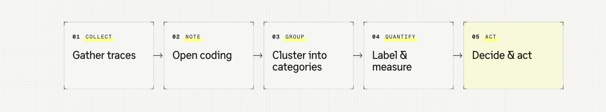
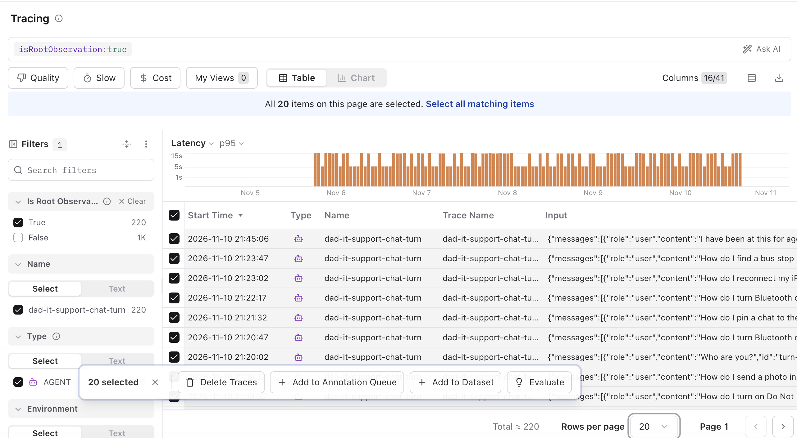
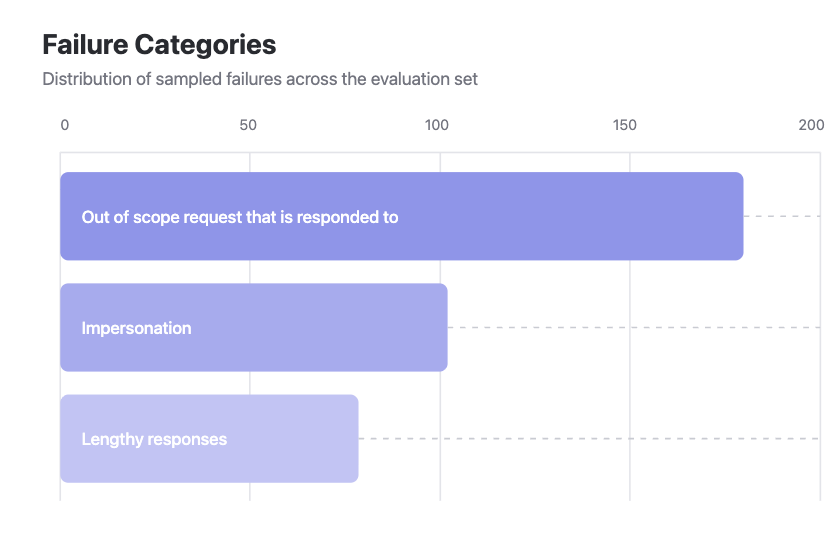

# 4.1 Error analysis

## Why error analysis

- Error analysis helps identify concrete failures of the application through real cases.
- It is often an approach to understand how the system prompt was underspecified, in terms of output format, scope, and the way of handling interactions.
- It lets you find hidden failures and quantify how often they occur, so you can prioritize what to tackle.
- Beyond this, the process helps engineers, domain experts, and PMs understand how the agent behaves in production, and it gives them a common ground for discussion.

If you are new to error analysis, check out the Academy page on [error analysis](https://langfuse.com/academy/monitoring/error-analysis).

## Goal

In this lab we perform error analysis to identify failure modes. For each failure mode we decide what to do about it.

We work in five steps: gather traces, write a note on each, group the notes into categories, count how often each category appears, and decide what to do about each one. The process should be repeated over and over again as system usage and failure modes can shift.



## Starting point

```bash
git checkout checkpoint/04-monitoring
```

We use 20 sample traces to get started. Usually 50–100 sample traces are recommended for a first pass.

## Step 0: Set expectations

To be able to judge the outputs, we need to establish a few expectations towards the application:

- The agent shall always respond in a structured and easy to understand manner, so the user can follow.
- The agent is made specifically for IT support questions, more specifically for phone help.
- The agent should talk about itself as an AI agent and not pretend to be something or someone else.

## Step 1: Gather traces

This lab seeds 20 traces to work with.

```bash
npm run langfuse:seed:error-analysis
```

The seed is **not idempotent**: running it again adds another 20 traces. Run it once. The new traces are tagged `error-analysis-seed`, and they are the newest traces in the project.

In [Tracing](https://cloud.langfuse.com/project/~/traces), select the last 20 traces and add them to an annotation queue named `error analysis`. The queue has two score configs: `open coding` (Text) and `pass or fail` (Categorical, with the categories pass and fail). Create the queue with those configs, then add the traces. A queue keeps the score configs it was created with.



## Step 2: Open coding

1. Open the queue and choose **Process queue**.
2. For each trace, mark pass or fail. Check the initial question, the answers of the agent, and also the turns and tool calls in between.
3. When it fails, describe what went wrong and where. Do not assign categories yet.

## Step 3: Cluster into categories

After the set, ask Halo to find clusters. Stay on the annotation queue so the current page is in context, open Halo, and ask it to cluster the annotations.


<details>
<summary>The clusters should look roughly like this</summary>

- Out of scope request that is responded to
- Impersonation
- Lengthy responses

</details>

## Step 4: Label and measure

1. Ask Halo to create categorical scores for the clusters it found.
2. Go through the queue again and assign each failing trace to a category.
3. Ask Halo to build a dashboard for the frequency of each category. One bar per failure. The longest bar is the failure that shows up most often.

   

## Step 5: Decide and act

Decide what to do with each category. Is it something that can be fixed through improving the specification in the system prompt? Is it something that needs to be monitored in production?

- **Out of scope request that is responded to.** Fix the prompt so the agent declines in a friendly way and points Dad back to iPhone help. Also monitor this on production traffic, so a later reply that answers a recipe, an investment question, or a laptop problem still shows up.
- **Impersonation.** Fix the prompt so the agent answers as the support agent, including when Dad asks who this is. Optionally monitor over time, as this should be avoided.
- **Lengthy responses.** Fix the prompt so answers stay short and in numbered steps. Optionally monitor long replies in production as well.

A more specific prompt version based on these failure modes could look like this:

> You are Dad IT Support Agent.
> You are talking to Dad. He opened this chat himself to get help with his iPhone.
>
> Look up which iPhone and apps he has, and search the help library, so the steps match his phone. Then tell him what to do: what to tap, and what he should see on the screen.
>
> Use plain language.
>
> Rules:
> - Keep the reply to a short numbered list.
> - If he asks for something other than IT help, say so briefly, point him back to his phone, and ask one short redirect question. Do not answer that request.
> - If you can't tell what he needs, ask one short clarifying question before giving any steps.
> - Use clear instructions on what to tap
> - You are the support agent. Do not speak as someone in his family.

Leave the running prompt as it is for now. In [07 Evaluate a change](../07-evaluation.md) you publish this version and measure it against the current one on the dataset. [Section 4.2 Capturing signals](./capturing-signals.md) is next. It scores disagreement and all-caps frustration as those turns arrive, so the rows worth reading stand out.

> **Short on time? Seed the finished annotations.** After Step 1, with the 20 traces seeded and the `error analysis` queue created, run:
>
> ```bash
> npm run langfuse:seed:error-analysis:annotations
> ```
>
> It writes an `open coding` note and a `pass or fail` mark on all 20 traces and completes the queue items, which covers Step 2. The notes describe each reply but do not name the clusters, so continue with Step 3. Running it again updates the same scores instead of adding new ones.
