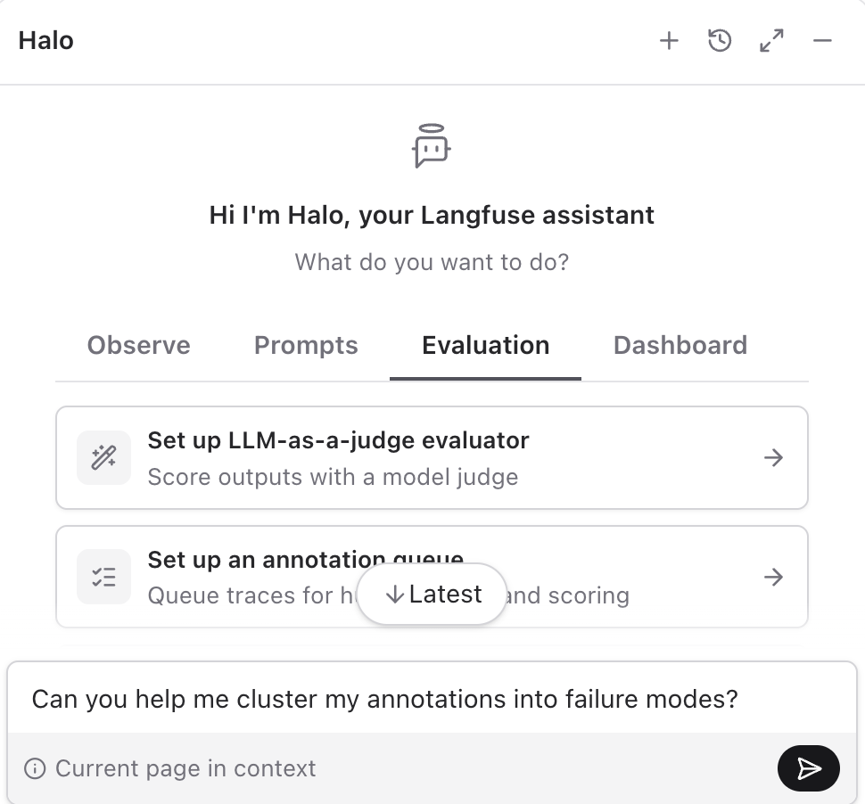

# 4.1 Error analysis

Part of [04 Monitoring](../04-monitoring.md).

Error analysis finds failure modes by open-coding traces, then clustering those notes. This lab uses its own batch of 22 traces.

## Seed the traces

This lab seeds its own 22 traces. Seven are ordinary one-turn iPhone questions. The other 15 each contain one problem. Some of those are a single turn, and some are a longer session of two or three turns.

```bash
npm run langfuse:seed:error-analysis
```

The seed writes no scores. It is **not idempotent**: running it again adds another 22 traces. Run it once. The new traces are tagged `error-analysis-seed`, and they are the newest traces in the project.

## Annotate

1. In [Tracing](https://cloud.langfuse.com/project/~/traces), select the last 22 traces and add them to an annotation queue. The queue has two score configs: **open coding** (Text) and **pass/fail** (Categorical, with the categories pass and fail). Create the queue with those configs, then add the traces. A queue keeps the score configs it was created with.
2. Open the queue and choose **Process queue**.
3. For each trace, mark pass or fail.
4. When it fails, inspect the trace and write the failure in open coding. Describe what went wrong. Leave the notes ungrouped.
5. Finish the set before you cluster. The notes are the input to the next step.
6. After the set, ask Halo to find clusters. Stay on the annotation queue so the current page is in context, open Halo, and ask it to cluster the annotations.

   

   The clusters should look roughly like this:

   - Out of scope request that is responded to
   - Impersonation
   - Lengthy responses

7. Ask Halo to create categorical scores for the clusters it found.

8. Go through the queue again and assign each failing trace to a category.
9. Ask Halo to build a dashboard for the frequency of each category.

   > **TODO:** Add how that dashboard should look.

10. Decide what to do with each category.

    - **Out of scope request that is responded to.** Fix the behavior so Specs declines an out-of-scope request in a friendly way and points Dad back to iPhone help. Also monitor this on production traffic, so a later reply that answers a recipe, an investment question, or a laptop problem still shows up.
    - **Impersonation.** Fix it in the system prompt, so Specs answers as the support agent.
    - **Lengthy responses.** Fix it in the system prompt, so answers stay short and in numbered steps. Optionally monitor long replies in production as well.

The full version of this targets on the order of 100 traces. This lab uses 20. The [annotation queue docs](https://langfuse.com/docs/evaluation/evaluation-methods/annotation-queues) cover the queue controls, and the Academy page on [error analysis](https://langfuse.com/academy/monitoring/error-analysis) is the longer method.
