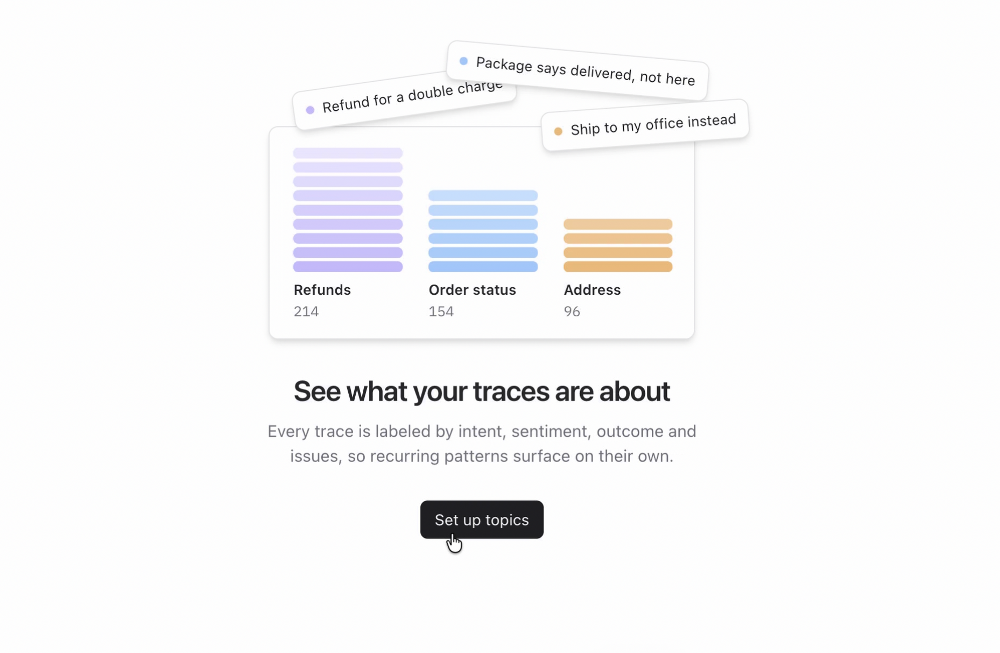
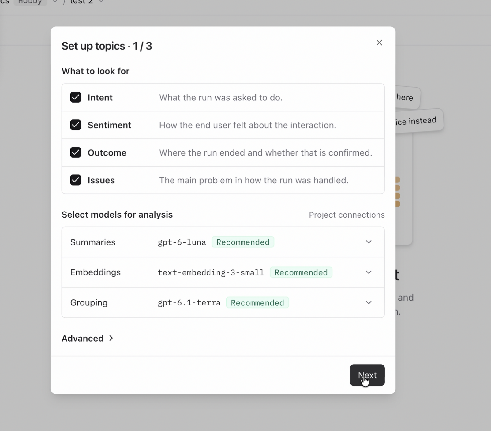
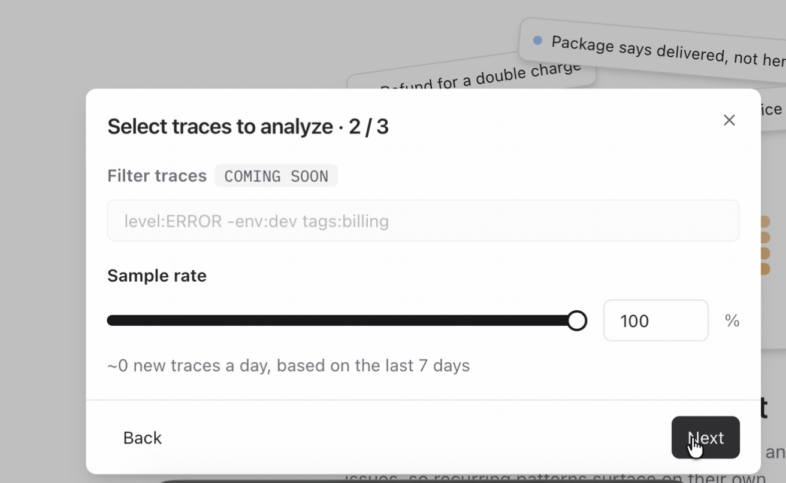
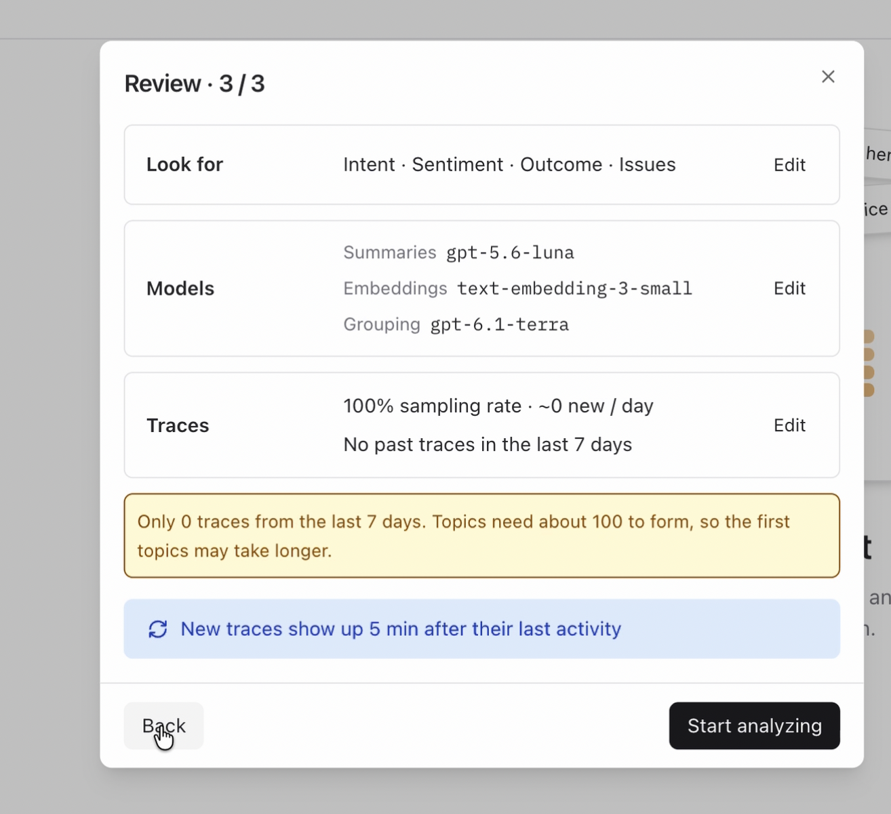

# Topics and issues

Part of [04 Monitoring](../04-monitoring.md).

Topics labels every trace by intent, sentiment, outcome, and issues, then groups the ones that belong together. Seed the traces, set Topics up, then read what the groups say about Specs.

```bash
git checkout checkpoint/04-monitoring
```

## Seed the traces

```bash
npm run langfuse:seed:topics
```

This loads 200 traces spread over the last five days. Most are ordinary iPhone questions, some one turn and some two or three. Forty are laptop requests in two loose groups: the printer and its paper, and the laptop's Wi-Fi. The wording varies inside each group. Thirty are follow-ups where Dad says the steps did not work. The seed writes no scores, and every trace is tagged `topics-seed`.

> ⚠️ The seed is **not idempotent**. OpenTelemetry mints fresh trace IDs on every run, so re-running doubles the data. Run it once. If you need a clean slate, delete the prior seed traces in Langfuse before seeding again.

Open [Tracing](https://cloud.langfuse.com/project/~/traces) and filter to the `production` environment. Then open [Topics](https://cloud.langfuse.com/project/~/topics).

The model list comes from the project's LLM connections. If the dropdowns in the next step are empty, add an OpenAI connection first: Project Settings → LLM Connections → Add LLM Connection. The [capturing signals](./capturing-signals.md) section uses that same connection.

## Set up topics

1. On the empty Topics page, click **Set up topics**.

   

2. Under **What to look for**, leave all four checked:

   - **Intent** — what the run was asked to do.
   - **Sentiment** — how the end user felt about the interaction.
   - **Outcome** — where the run ended, and whether that is confirmed.
   - **Issues** — the main problem in how the run was handled.

   Under **Select models for analysis**, keep the models marked **Recommended**: summaries, embeddings (`text-embedding-3-small`), and grouping. Click **Next**.

   

3. On **Select traces to analyze**, leave the sample rate at **100%**. Trace filters are not available yet. Click **Next**.

   

4. On **Review**, check that **Look for** is Intent, Sentiment, Outcome, and Issues, then click **Start analyzing**.

   The review tells you how many traces from the last 7 days it can use. Topics need about 100 traces before the groups settle, so a smaller batch can take longer to form. New traces show up about 5 minutes after their last activity. If the review says there are no past traces, the seed in this section has not landed in that window yet.

   

## Insights

When the page fills in, the tabs are **Intent**, **Sentiment**, **Outcome**, and **Issues**. **Visualize as** can stay on **Treemap**. **Auto-analyze** stays on, so later traces are labeled the same way.

Click a tile. The list under it is the traces in that group, each with a one-line summary. **Open in Tracing** shows those same traces in the trace table. Tile names come from the model, so yours will be close to the ones below, not necessarily identical.


### The four tabs are a map of the system

Start by walking the tabs, before looking for something to fix. Intent is the kinds of help Dad asked for. Sentiment is how the conversation felt. Outcome is where it ended. Issues is what went wrong in the handling, including when the same problem sits under more than one intent.

That first pass is the point of Topics. A few hundred traces become a handful of classes you can name. Some of what you see is the product working: iPhone tasks grouping together, ordinary requests landing cleanly. You are learning the shape of the system, not only hunting failures.

### Laptop help is a chance to widen what Specs supports

On **Intent**, look for two groups that are not iPhone tasks: one about the laptop's Wi-Fi, and one about printing from the laptop, including paper jams and paper in the tray. The iPhone is the device Specs is built for. These requests sit outside that, and Specs answers them anyway.

Open a few of those traces. The answer does not ask which laptop Dad has. It hedges every time: if it is Windows, do this; if it is a Mac, do this.

That hedge is the gap, and the fix is context, not a refusal. `DEFAULT_SUPPORT_CONTEXT` in `src/server/support-data.ts` already lists Dad's iPhone under `devices`. Add the laptop there, next to the phone. Specs can then give the steps for that machine instead of both. A cluster that looks out of scope is a chance to extend what the product supports.

A tile summary may describe these replies as unsupported and suggest sending Dad back to iPhone help. Read the traces before you take that suggestion. Specs is already trying to help. Telling it which laptop Dad uses makes those answers specific.

### The same laptop gap shows up under Issues

On **Issues**, one of the larger groups is answers that give guidance without confirming the setup. The name may be close to "Unclarified Setup or Support Scope". Open it. The laptop traces are here too: Specs tries to answer the printer or Wi-Fi question, and the steps stay generic because it never asks which device this is. The Windows branch and the Apple branch are both in the reply. The same context change, adding the laptop beside the iPhone, is what makes these specific.

### Repeated steps after Dad says it failed

**Issues** also has a group for troubleshooting that repeats. The name may be close to "Repeated Failed Troubleshooting", and it is about 30 traces. These are the two- and three-turn sessions where Dad says the steps did not work ("I did that, but nothing changed", "I can't find that option") and Specs sends the same numbered list again. They hide inside ordinary intents such as Bluetooth or WhatsApp, which is why they show up together here and not as their own intent.

The fix belongs in the system prompt: when Dad says a step failed, ask what he sees on screen and try a different path instead of repeating the list.

### A search that looks wrong, and an answer that still works

**Issues** also has a group for searches that do not match the question. The name may be close to "Off-target search queries". Open a few traces. The help-library query or result is unrelated, and the final answer still covers what Dad asked. The summaries say the mismatch was an extra step, not the thing that decided the turn.

That is not a failure to patch in this session. It raises a question about the library. How often does `search_help_library` actually help, and which requests does it have nothing useful for? That is worth a closer look at the guides in `src/server/support-data.ts` before treating the tile as a broken answer.

[Capturing signals](./capturing-signals.md) is the next section. It attaches scores to new turns so disagreement and all-caps frustration stand out in the trace table.
