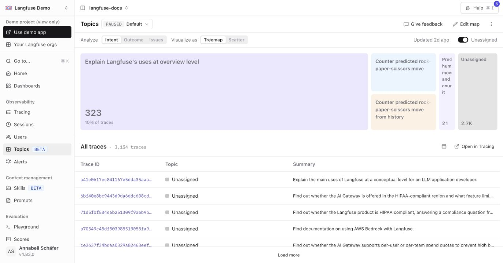

# 4.2 Detect topics and issues

## Why topics and issue detection

Topics turns trace-level data into a map of what your agent handles, where runs end, and what goes wrong. It is useful when the trace volume is too large to read one by one.

The map is a starting point for questions such as:

- Which requests are we handling in production?
- Which groups suggest an opportunity to expand the product?
- Which recurring issues should become prompt changes, tools, or evaluators?

Topic names and group sizes are model-generated. Your result will not be identical to the examples in this lesson.

In this lab we will detect topics and issues in 200 sample traces.

```bash
git checkout checkpoint/04-monitoring
```

## Seed the traces

```bash
npm run langfuse:seed:topics
```

> ⚠️ The seed is **not idempotent**. OpenTelemetry mints fresh trace IDs on every run, so re-running doubles the data. Run it once. If you need a clean slate, delete the prior seed traces in Langfuse before seeding again.

Open [Tracing](https://cloud.langfuse.com/project/~/traces) if you want to inspect the seeded traces first. Then open [Topics](https://cloud.langfuse.com/project/~/topics).

## Add the model connection

Topics needs an LLM connection in the project. Add an OpenAI connection before editing the map. [Section 4.3 Capturing signals](./capturing-signals.md) uses this same connection.

1. In Langfuse, open **Project Settings → LLM Connections**.
2. Click **Add LLM Connection**.
3. Choose OpenAI, name the connection, and paste your OpenAI API key into the secret field.
4. Save the connection.

If a connection is already there, keep it and continue. Keep the API key in the Langfuse secret field only. Do not paste it into workshop transcripts or shared notes.

## Configure the topic map

Current Langfuse projects can configure a map from **Edit map**. This is not a fixed setup wizard: the available facets and trace filters belong to the map, and they can be changed later.

1. On **Topics**, click **Edit map**.

   

2. In **Name**, keep `Default` or give the map a name that describes the app it covers.

3. Under **Facets · What to look for**, enable the facets you want to compare:

   - **Intent:** what the run was asked to do.
   - **Sentiment:** how the end user felt about the interaction.
   - **Outcome:** where the run ended and whether that is confirmed.
   - **Issues:** the main problem in how the run was handled.

   For this workshop, enable **Intent**, **Sentiment**, **Outcome**, and **Issues**. A project may have a different selection, so do not assume that every facet is present in every map.

   

4. Under **Filter traces**, use **Query** or **Builder** to limit the map to the traces for this app. Topics runs at trace level. If the project contains several agents or applications, filtering prevents them from being mixed into one map. For this workshop, leave the filter broad enough to include the seeded traces.

5. Check the matching-trace count. The map uses a recent time window, so a correct seed can still be absent if it is outside the last 7 days or has not become eligible yet. New traces can take about 5 minutes after their last activity to appear.

6. Leave **Live updates** enabled if it is available. Live updates analyze new matching traces as they arrive and refit the map nightly. Leave the **Sampling rate** at 100% for this lab, then save the map.

If the map is marked **PAUSED**, do not describe it as continuously analyzing new traces. The header status tells you whether the selected map is active; the map selector can contain more than one map.

## Explore the map

When analysis is ready, choose a facet from the tabs under **Analyze**. Only enabled facets appear. Choose **Treemap** for a size-based overview or **Scatter** for an embedding view of the groups.

The **Unassigned** toggle controls whether traces without a topic are included. The topic tiles show model-generated names, counts, and percentages. Click a tile to see the matching traces and their summaries. **Open in Tracing** takes you to the corresponding trace list so you can read the full conversations instead of trusting a label alone.


On **Scatter**, inspect the groups and the trace list together. You can search the results with filters such as an assignment or topic, then open the matching traces in Tracing.


On **Issues**, open a group and read several traces before calling it a failure. A model-generated issue can be too broad, can overlap with an intent, or can describe a symptom rather than the cause.


## Apply the map to the Dad IT Support Agent

Walk through the enabled facets before choosing a fix. Intent shows the kinds of help Dad requested. Sentiment shows how conversations felt. Outcome shows where they ended. Issues shows recurring problems in the handling. Some groups will show the agent working as expected; topics are not only a failure list.

Use the seeded traces to investigate these questions. The exact names, counts, and grouping can vary between runs:

1. On **Intent**, look for laptop Wi-Fi and laptop printing requests. The app is designed around Dad's iPhone, so these requests expose missing context. Open several traces and check whether the answer asks which laptop Dad uses. The useful change is to add Dad's laptop next to his phone in `DEFAULT_SUPPORT_CONTEXT`, which `get_support_context` returns.

2. On **Sentiment**, look for frustration around unresolved Wi-Fi or troubleshooting conversations. A few all-caps messages and replies such as “No, that menu isn't there” are good candidates for the conversation signals in [Section 4.3 Capturing signals](./capturing-signals.md). Topics help you find the pattern; the signal evaluator will help you find future individual turns.

3. On **Issues**, look for conversations where Dad says the steps failed and the agent repeats them. Read the traces to confirm the issue before changing the prompt. A useful prompt rule is to ask what Dad sees and try a different path instead of repeating the same list.

4. If an issue reports a mismatched help-library search but the final answer still helps, inspect the tool call and answer before patching the agent. It may be a library-coverage question rather than an answer-quality failure.

Every generation of topics is non-deterministic because an LLM helps create the groups. Treat the labels as hypotheses: open representative traces, decide what the group means, and then turn the useful patterns into prompt changes, tools, or evaluators.

Leave the running prompt as it is for now. The next section turns the frustration and disagreement patterns into production signals.
