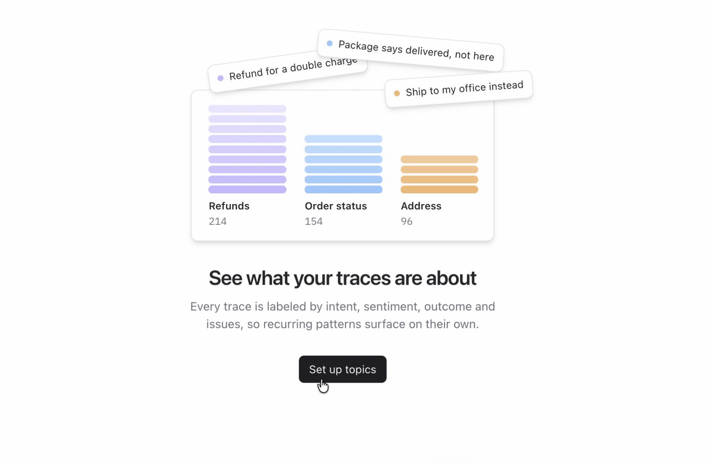
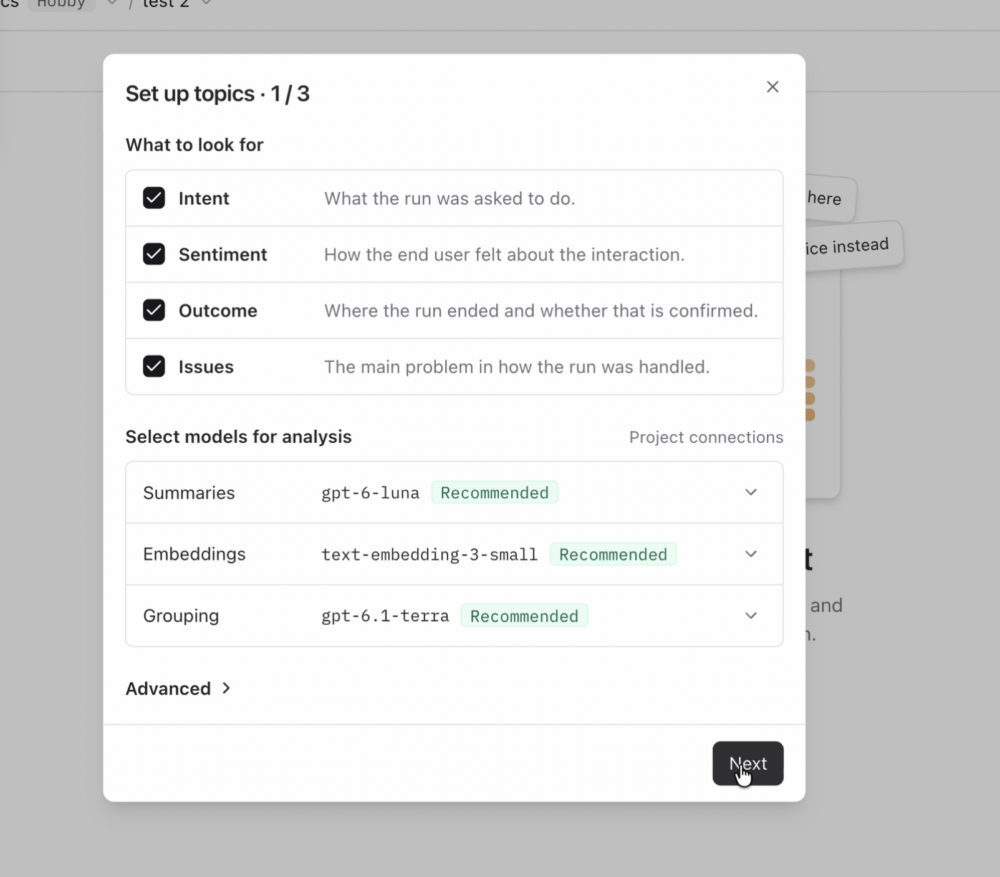
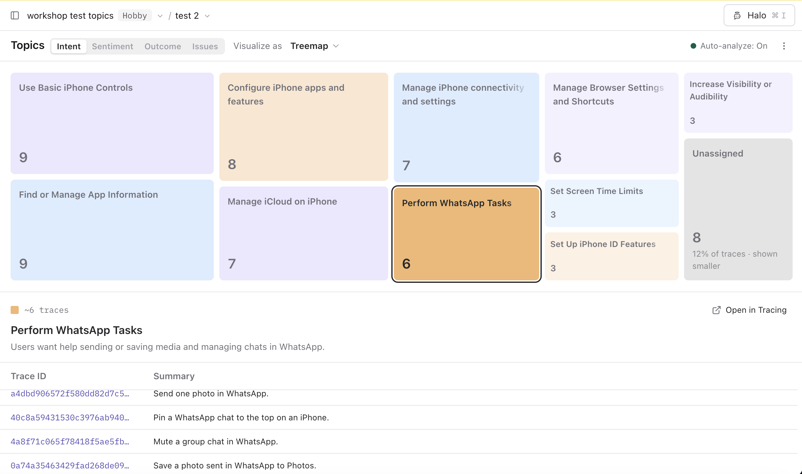
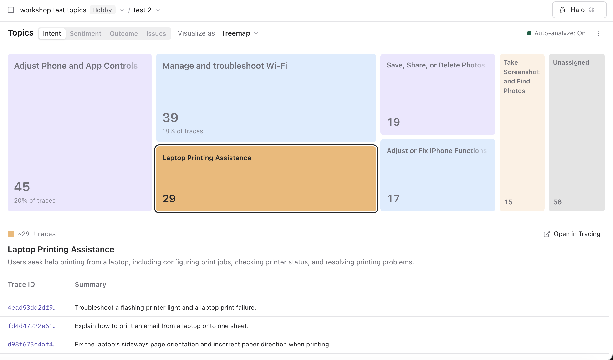
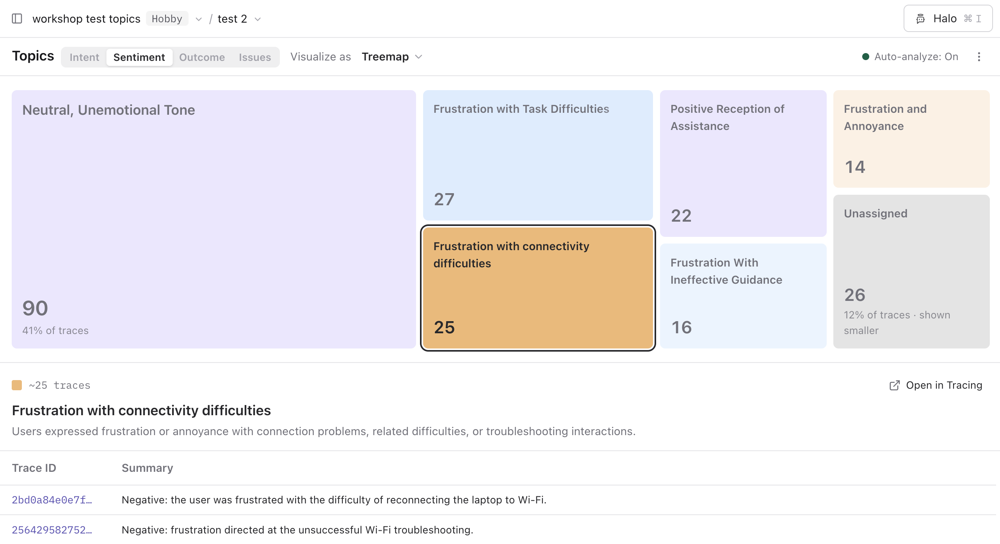
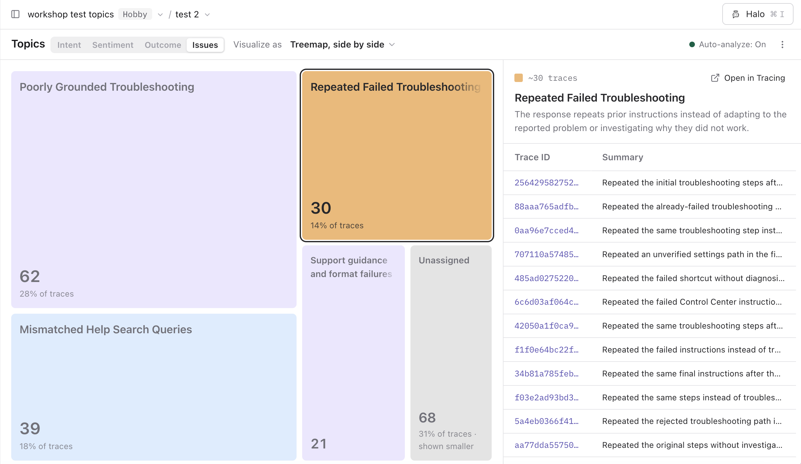
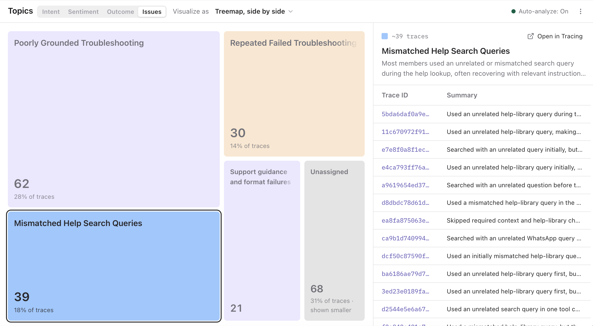

# 4.2 Detect topics and issues

## Why topics and issue detection

Topics and issue detection groups trace data at scale by intent, sentiment, outcome, and issues.

Topics gives you a map of what your agent is handling in production, how users are feeling about the system, and where it fails.

The facets give you a starting point to dig deeper:

- There might be insights on expansion opportunities for your system.
- Some things might show up as failures and still be a sign that the system should change.
- They can give you inspiration for what kind of evaluators to set up.

## Goal

Detect topics and issues in 200 sample traces, then read the map for what Specs is asked to do, how Dad feels, and where the handling goes wrong.

## Starting point

```bash
git checkout checkpoint/04-monitoring
```

## Step 1: Seed the traces

```bash
npm run langfuse:seed:topics
```

The seed is **not idempotent**. OpenTelemetry mints fresh trace IDs on every run, so re-running doubles the data. Run it once. If you need a clean slate, delete the prior seed traces in Langfuse before seeding again.

Open [Tracing](https://cloud.langfuse.com/project/~/traces) if you want to inspect the seeded traces first. Then open [Topics](https://cloud.langfuse.com/project/~/topics).

## Step 2: Add the model connection

The model list in the next step comes from the project's LLM connections. Add an OpenAI connection now. [Section 4.3 Capturing signals](./capturing-signals.md) uses this same connection.

1. In Langfuse, open **Project Settings → LLM Connections**.
2. Click **Add LLM Connection**.
3. Choose OpenAI, name the connection, and paste your OpenAI API key into the secret field.
4. Save the connection.

If a connection is already there, keep it and continue.

Keep the API key in the Langfuse secret field only. Do not paste it into workshop transcripts or shared notes.

## Step 3: Set up topics

1. On the empty Topics page, click **Set up topics**.

   

2. Under **What to look for**, leave all four checked:

   - **Intent:** what the run was asked to do.
   - **Sentiment:** how the end user felt.
   - **Outcome:** where the run ended, and whether that is confirmed.
   - **Issues:** the main problem in how the run was handled.

   Under **Select models for analysis**, keep the models marked **Recommended**. Embeddings stays on `text-embedding-3-small` when that badge is on it. Click **Next**.

   

3. On **Select traces to analyze**, leave the trace filters empty and the sample rate at **100%**. Click **Next**.

   This project traces one agent, so an empty filter is the right setup. The filter is for a project that sends several agents or applications into the same place. Keep one project per use case. When traces from different agents do share a project, filter each map to one of them, usually by trace name, tags, or environment, and add another map for the rest. Skip that here.

4. On **Review**, check that **Look for** is Intent, Sentiment, Outcome, and Issues, then click **Start analyzing**.

   The review says the run covers up to 500 recent traces that match the filter, and that first results from those traces take about 3 to 5 minutes. New traces show up 5 minutes after their last activity. This seed already places the newest trace more than 5 minutes before now, and the batch sits inside the last few days, so the review should list them. A first map still forms from a smaller batch: about 20 summaries on a facet is enough for a provisional grouping. If fewer than about 100 matching traces are in the last 30 days, the review warns that the first groups can take longer to settle.

## Step 4: Read the map

When the page fills in, the tabs are **Intent**, **Sentiment**, **Outcome**, and **Issues**. The default view is Treemap.

Click a tile. The list under it is the traces in that group, each with a one-line summary. **Open in Tracing** shows those same traces in the trace table. A model names the tiles after the groups form, so yours will be close to the ones below, and the counts will not match exactly.



### The four tabs are a map of the system

Start by walking the tabs, before looking for something to fix. Intent is the kinds of help Dad asked for. Sentiment is how the conversation felt. Outcome is where it ended. Issues is what went wrong in the handling, including when the same problem sits under more than one intent.

A few hundred traces become a handful of groups. Some of what you see is the product working: iPhone tasks grouping together, ordinary requests landing cleanly. You are learning the shape of how the system is used in production, including the requests that succeed. It also helps to understand how the system is used over time. A topic that mattered last month, during a special event, may be rare now.

The groups themselves are close to deterministic. A model names and describes them afterward, which is why the tile names move a little from run to run. Below is a walkthrough of one run of this data.

### Insight 1: Laptop help is a chance to widen what Specs supports

On **Intent**, look for two of the larger groups that are not iPhone tasks: one about the laptop's Wi-Fi, and one about printing from the laptop, including paper jams and paper in the tray. The iPhone is the device Specs is built for. These requests sit outside that, and Specs answers them anyway.

In this run the printing tile is **Laptop Printing Assistance**, 29 traces. The summaries are print jobs, a flashing printer light, and paper that comes out sideways.



Open a few of those traces. The answer does not ask which laptop Dad has. It hedges every time: if it is Windows, do this; if it is a Mac, do this.

The agent is trying to be helpful, and it is missing the context it needs to answer the question. This is a context problem, and we can provide that context through the `get_support_context` tool. `DEFAULT_SUPPORT_CONTEXT` in `src/server/support-data.ts` already lists Dad's iPhone under `devices`, and that is what the tool returns. Add the laptop there, next to the phone. Specs can then give the steps for that machine.

A tile summary may describe these replies as unsupported and suggest sending Dad back to iPhone help. Read the traces before you take that suggestion. Specs is already trying to help. Telling it which laptop Dad uses makes those answers specific.

The prompt still names only the iPhone. A more specific prompt version based on these laptop requests could look like this:

> You are Dad IT Support Agent.
> You are talking to Dad. He opened this chat himself to get help with his phone and his laptop.
>
> Look up which phone and laptop he has, and search the help library, so the steps match that device. Then tell him what to do: what to tap, and what he should see on the screen.
>
> Use plain language.
>
> Rules:
> - Keep the reply to a short numbered list.
> - If he asks for something other than IT help, say so briefly, point him back to his phone or his laptop, and ask one short redirect question. Do not answer that request.
> - If you can't tell what he needs, ask one short clarifying question before giving any steps.
> - Use clear instructions on what to tap
> - You are the support agent. Do not speak as someone in his family.

Leave the running prompt as it is for now. The laptop belongs in the prompt because Dad is already asking about it. The prompt you publish in [07 Evaluate a change](../07-evaluation.md) is the one from [section 4.1 Error analysis](./error-analysis.md), which still points non-IT requests back to his phone.

### Insight 2: Sentiment shows the frustration

On **Sentiment**, the largest tile is still calm. The name is close to "Neutral, Unemotional Tone". Frustration does not land as one block. It splits into a few tiles, with names close to "Frustration with Task Difficulties", "Frustration with connectivity difficulties", "Frustration With Ineffective Guidance", and "Frustration and Annoyance".

Click the connectivity one. It is about 25 traces. The summaries say Dad was frustrated that the laptop would not reconnect to Wi-Fi, or that the Wi-Fi troubleshooting did not work.



A few of those messages are in all caps ("THIS STILL ISNT WORKING"), and a few push back ("No, that menu isn't there"). [Section 4.3 Capturing signals](./capturing-signals.md) is next, and it turns this feeling into two scores: Dad disagreeing with the steps, and Dad writing in all caps.

### Insight 3: Repeated steps after Dad says it failed

On **Issues**, one tile in this run is **Repeated Failed Troubleshooting**, 30 traces. The tile says the response repeats prior instructions instead of adapting to the reported problem or investigating why they did not work.



These are the two- and three-turn sessions where Dad says the steps did not work ("I did that, but nothing changed", "I can't find that option") and Specs sends the same numbered list again. They hide inside ordinary intents such as Bluetooth or WhatsApp, which is why they show up together here and not as their own intent.

The fix could live in the system prompt: when Dad says a step failed, ask what he sees on screen and try a different path.

### Insight 4: A search that looks wrong, and an answer that still works

On **Issues**, one tile in this run is **Mismatched Help Search Queries**, 39 traces. The tile says most of these traces used an unrelated or mismatched search query during the help lookup, and often still recovered with relevant instructions.



Open a few traces. The help-library query or result is unrelated, and the final answer still covers what Dad asked. The summaries say the mismatch was an extra step, and the answer still landed.

Leave this tile for a later look at the library. How often does `search_help_library` actually help, and which requests does it have nothing useful for? That is a closer look at the guides in `src/server/support-data.ts`.

Halo can read this map. From the Topics page, ask it to open a group, point at the step in the trace that led to the issue, and flag tiles that look like false positives. Use the tile as a starting point, then read the traces.

[Section 4.3 Capturing signals](./capturing-signals.md) is next. It is one of those evaluators: a score for disagreement, and a score for all-caps frustration.
