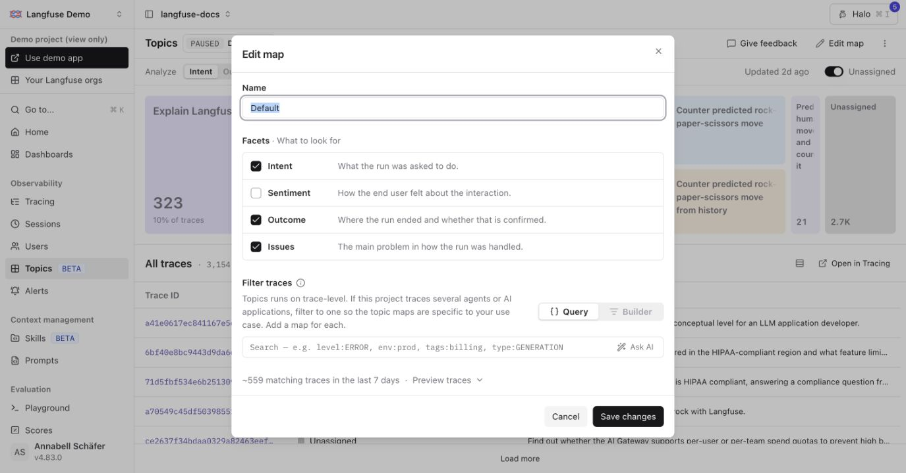
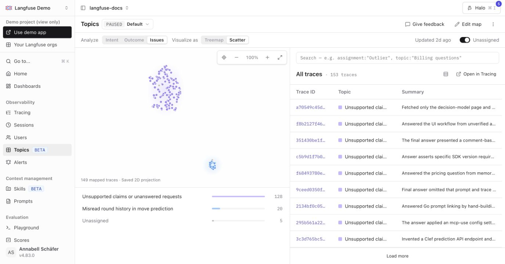

# 4.2 Detect topics and issues

## Why topics and issue detection

Topics turns trace-level data into a map of what your agent handles, where runs end, and what goes wrong. It is useful when the trace volume is too large to read one by one.

The map is a starting point for questions such as:

- Which requests are we handling in production?
- Which groups suggest an opportunity to expand the product?
- Which recurring issues should become prompt changes, tools, or evaluators?

Topic names and group sizes are model-generated. Your result will not be identical to the examples in this lesson.

In this lab we will detect topics and issues in 200 sample traces.

```bash
git checkout checkpoint/04-monitoring
```

## Seed the traces

```bash
npm run langfuse:seed:topics
```

> ⚠️ The seed is **not idempotent**. OpenTelemetry mints fresh trace IDs on every run, so re-running doubles the data. Run it once. If you need a clean slate, delete the prior seed traces in Langfuse before seeding again.

Open [Tracing](https://cloud.langfuse.com/project/~/traces) if you want to inspect the seeded traces first. Then open [Topics](https://cloud.langfuse.com/project/~/topics).

## Add the model connection

Topics needs an LLM connection in the project. Add an OpenAI connection before editing the map. [Section 4.3 Capturing signals](./capturing-signals.md) uses this same connection.

1. In Langfuse, open **Project Settings → LLM Connections**.
2. Click **Add LLM Connection**.
3. Choose OpenAI, name the connection, and paste your OpenAI API key into the secret field.
4. Save the connection.

If a connection is already there, keep it and continue. Keep the API key in the Langfuse secret field only. Do not paste it into workshop transcripts or shared notes.

## Configure the topic map

Current Langfuse projects can configure a map from **Edit map**. This is not a fixed setup wizard: the available facets and trace filters belong to the map, and they can be changed later.

1. On **Topics**, click **Edit map**.

   

2. In **Name**, keep `Default` or give the map a name that describes the app it covers.

3. Under **Facets · What to look for**, enable the facets you want to compare:

   - **Intent:** what the run was asked to do.
   - **Sentiment:** how the end user felt about the interaction.
   - **Outcome:** where the run ended and whether that is confirmed.
   - **Issues:** the main problem in how the run was handled.

   For this workshop, enable **Intent**, **Sentiment**, **Outcome**, and **Issues**. A project may have a different selection, so do not assume that every facet is present in every map.

   

4. Under **Filter traces**, use **Query** or **Builder** to limit the map to the traces for this app. Topics runs at trace level. If the project contains several agents or applications, filtering prevents them from being mixed into one map. For this workshop, leave the filter broad enough to include the seeded traces.

5. Check the matching-trace count. The map uses a recent time window, so a correct seed can still be absent if it is outside the last 7 days or has not become eligible yet. New traces can take about 5 minutes after their last activity to appear.

6. Leave **Live updates** enabled if it is available. Live updates analyze new matching traces as they arrive and refit the map nightly. Leave the **Sampling rate** at 100% for this lab, then save the map.

If the map is marked **PAUSED**, do not describe it as continuously analyzing new traces. The header status tells you whether the selected map is active; the map selector can contain more than one map.

## Explore the map

When analysis is ready, choose a facet from the tabs under **Analyze**. Only enabled facets appear. Choose **Treemap** for a size-based overview or **Scatter** for an embedding view of the groups.

The **Unassigned** toggle controls whether traces without a topic are included. The topic tiles show model-generated names, counts, and percentages. Click a tile to see the matching traces and their summaries. **Open in Tracing** takes you to the corresponding trace list so you can read the full conversations instead of trusting a label alone.


On **Scatter**, inspect the groups and the trace list together. You can search the results with filters such as an assignment or topic, then open the matching traces in Tracing.


On **Issues**, open a group and read several traces before calling it a failure. A model-generated issue can be too broad, can overlap with an intent, or can describe a symptom rather than the cause.



## Apply the map to the Dad IT Support Agent

Walk through the enabled facets before choosing a fix. Intent shows the kinds of help Dad requested. Sentiment shows how conversations felt. Outcome shows where they ended. Issues shows recurring problems in the handling. Some groups will show the agent working as expected; topics are not only a failure list.

Every generation of topics is non-deterministic because an LLM helps create the groups. The names and counts below describe one run of the workshop data. Yours may be different. Treat the labels as hypotheses: open representative traces, decide what the group means, and then turn the useful patterns into prompt changes, tools, or evaluators.

### Insight 1: Laptop help is a chance to widen what Specs supports

On **Intent**, look for two larger groups that are not iPhone tasks: one about the laptop's Wi-Fi, and one about printing from the laptop, including paper jams and paper in the tray.

The iPhone is the device Specs is built for. These requests sit outside that, and Specs answers them anyway. Open several traces. The answer does not ask which laptop Dad has. It hedges every time: if it is Windows, do this; if it is a Mac, do this.

The agent is trying to be helpful while missing the context it needs. This is a context problem, and we can provide that context through the `get_support_context` tool. `DEFAULT_SUPPORT_CONTEXT` in `src/server/support-data.ts` already lists Dad's iPhone under `devices`, and that is what the tool returns. Add the laptop there, next to the phone. Specs can then give the steps for that machine instead of both.

A tile summary may describe these replies as unsupported and suggest sending Dad back to iPhone help. Read the traces before taking that suggestion. Specs is already trying to help. Telling it which laptop Dad uses makes those answers specific.

The prompt still names only the iPhone. A more specific prompt version based on these laptop requests could look like this:

> You are Dad IT Support Agent.
> You are talking to Dad. He opened this chat himself to get help with his phone and his laptop.
>
> Look up which phone and laptop he has, and search the help library, so the steps match that device. Then tell him what to do: what to tap, and what he should see on the screen.
>
> Use plain language.
>
> Rules:
> - Keep the reply to a short numbered list.
> - If he asks for something other than IT help, say so in one short sentence and point him back to his phone or his laptop. Do not answer that request.
> - Use clear instructions on what to tap.
> - You are the support agent. Do not speak as someone in his family.

Leave the running prompt as it is for now. The laptop belongs in the prompt because Dad is already asking about it, not because the reply should be refused.

### Insight 2: Sentiment shows the frustration

On **Sentiment**, the largest group may still be calm or neutral. Frustration does not necessarily land as one block; it can split across several groups with names such as “Frustration with Task Difficulties,” “Frustration with connectivity difficulties,” “Frustration With Ineffective Guidance,” or “Frustration and Annoyance.”

Open the group that is about connectivity or troubleshooting. The summaries should include Dad being frustrated that the laptop would not reconnect to Wi-Fi, or that the Wi-Fi troubleshooting did not work.

A few messages are in all caps, such as “THIS STILL ISNT WORKING,” and a few push back: “No, that menu isn't there.” [Section 4.3 Capturing signals](./capturing-signals.md) is next, and it turns this feeling into two scores: Dad disagreeing with the steps, and Dad writing in all caps.

### Insight 3: Repeated steps after Dad says they failed

On **Issues**, look for a group about repeated failed troubleshooting. The description should say that the response repeats prior instructions instead of adapting to the reported problem or investigating why they did not work.

These are the two- and three-turn sessions where Dad says the steps did not work (“I did that, but nothing changed” or “I can't find that option”) and Specs sends the same numbered list again. They hide inside ordinary intents such as Bluetooth or WhatsApp, which is why they show up together here and not as their own intent.

The fix could live in the system prompt: when Dad says a step failed, ask what he sees on screen and try a different path instead of repeating the list.

### Insight 4: A search that looks wrong, and an answer that still works

On **Issues**, you may find a group about mismatched help-library searches. The tile can describe traces where the lookup query or result does not match the request, while the final answer still covers what Dad asked.

Open a few traces. The help-library query or result may be unrelated, but the final answer can still be useful. That is not automatically a failure to patch in this session. It raises a question about the library: how often does `search_help_library` actually help, and which requests does it have nothing useful for? Look at the guides in `src/server/support-data.ts` before treating the tile as a broken answer.

The useful next step is not to trust or reject a topic label blindly. Read enough traces to decide whether it is a prompt problem, a tool problem, or a missing-library-content problem. Then carry the strongest question into [Section 4.3 Capturing signals](./capturing-signals.md).

Leave the running prompt as it is for now. The next section turns the frustration and disagreement patterns into production signals.
