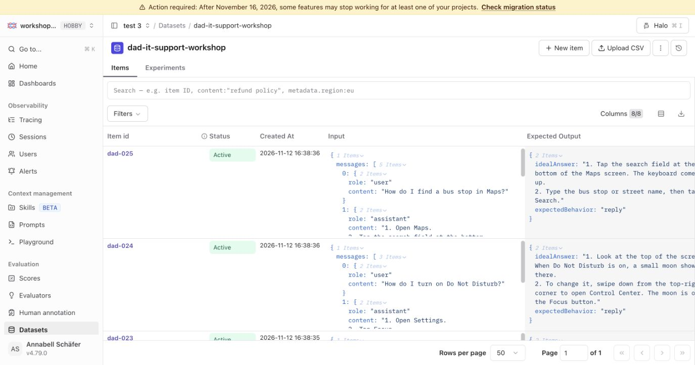

# 05 Build eval datasets

## Why build datasets

A dataset is your representation of what the system will face in production: the inputs you expect, and for each, what a good answer looks like. With a clear set of expectations written down, you can rerun the agent against them after every change and know whether you helped or hurt. A good dataset is the foundation for shipping confidently and iterating without regressing.

Complementary materials:

- Docs: [Datasets](https://langfuse.com/docs/evaluation/experiments/datasets)
- Academy: [Datasets](https://langfuse.com/academy/datasets)

## Goal

Create a first eval dataset that captures the kinds of requests Specs has to handle.

1. **Decide on the goal** for your eval dataset.
2. **Design the item shape**: every dataset item has the same three fields, and we want ours to match the agent's actual input.
3. **Seed the hosted dataset** so it lives in Langfuse and is ready for experiments in the next step.

## Starting point

```bash
git checkout checkpoint/05-dataset
```

You have a traced, attributed, monitored app. `data/seed-dataset.json` and `scripts/seed-dataset.ts` are already in the repo at this checkpoint.

Make sure `.env` has:

```bash
DATASET_NAME=dad-it-support-workshop
```

## Step 1: Decide on the goal for your eval dataset

Build your eval dataset from what you expect your system to hit in production, and from what is important to you: the things you want to evaluate to make sure the system works. A previous error analysis is a good place to start.

For Specs, two things matter most:

- **The answers are correct.**
- **The agent behaves appropriately**: it knows when to reply, when to defer a question, and when to ask a follow-up first. Error analysis showed that out-of-scope requests often get answered anyway.

On top of that, the dataset should cover the shapes of input we expect Specs to handle in production, at least the ones we have seen so far. It mixes cases that already work well, for example traces that passed error analysis, with cases that caused problems in the past and cases that must be handled correctly.

The starter dataset has 25 items. Nine come from the traces you reviewed in [4.1 Error analysis](./04-monitoring/error-analysis.md) (`"source": "error-analysis"`); the other 16 cover cases it didn't include (`"source": "starter"`), so the step 07 prompt is also measured on cases it wasn't written from. Together they cover:

- iPhone how-to questions, from Bluetooth and Wi-Fi to WhatsApp, Maps and photos
- Out-of-scope requests, such as a cake recipe or filing taxes
- Multi-turn conversations, such as a follow-up ("Where is the moon icon?") or an off-topic question after a fix
- Limits the agent must state, such as passwords or live location
- Vague requests that need a clarifying question first ("My phone is not working.")

If you add items later, prefer ones that match a real signal you saw in monitoring rather than items invented from scratch. For more on choosing what goes into a dataset, see the Academy page on [building datasets](https://langfuse.com/academy/datasets).

## Step 2: Design the item shape

Dataset items in Langfuse follow a consistent shape: three fields, one required, two optional:

| Field | Required | Purpose |
| --- | --- | --- |
| `input` | yes | What you'd feed the agent. For us, the same `{ messages: [...] }` shape `/api/chat` accepts. |
| `expectedOutput` | optional | What a good answer would look like. Free-form: used by evaluators to compare actual vs expected. |
| `metadata` | optional | Tags or other fields for filtering and grouping (`category`, `difficulty`, etc.). |

In our case, the conceptual shape of one item is:

```json
{
  "input": "How do I turn Bluetooth on on my iPhone?",
  "expectedOutput": {
    "idealAnswer": "1. Open the Settings app.\n2. Tap Bluetooth.\n3. Turn the Bluetooth switch on. It turns green when Bluetooth is on.",
    "expectedBehavior": "reply"
  },
  "metadata": { "category": "iphone-bluetooth", "difficulty": "easy", "source": "starter" }
}
```

The two fields inside `expectedOutput` match the two evaluation questions from Step 1:

- **`idealAnswer`**: is the answer correct? This is the reply we want, written the way the prompt asks for it, with only the steps that matter.
- **`expectedBehavior`**: did Specs behave appropriately? One of `reply`, `defer_question`, or `ask_follow_up`.

In chapter 06 you will see how each of these is evaluated.

`metadata` lets us slice runs by category, difficulty, or source later when comparing experiment runs side by side.

If you look at the actual JSON in `data/seed-dataset.json`, the `input` is the full `{ messages: [...] }` shape that `/api/chat` accepts, plus an `id` field for the dataset row. Multi-turn items carry the earlier user and assistant turns in that array, and the expectations apply to the last reply. We've simplified the example above to show *what an item is*; the on-disk format is what the experiment script (step 06) can feed straight into `runSupportConversation(...)` without rewriting inputs.

## Step 3: Seed the dataset

You have several options for getting items into a Langfuse dataset:

- **Add items manually** in the UI (Datasets → New item).
- **Upload a CSV / JSON** file via the UI.
- **Turn live production traces** into dataset items directly from the Trace view: this is the most powerful path once you have monitoring catching interesting traces.
- **Programmatic seeding** via the SDK / CLI: best for an initial bulk load like ours.

For this workshop we use the programmatic path because we already have a curated JSON file:

```bash
npm run dataset:seed
```

Open Langfuse → **Datasets**. The list view should show the new `dad-it-support-workshop` dataset with 25 items and 0 experiment runs (so far).

Click into the dataset and switch to the **Items** tab. You should see every seeded item with input, expected output, and metadata columns:



## How to verify you are done

- The dataset shows up in Langfuse with all items.
- Item inputs look like the `messages` array a real chat turn would have.
- You can articulate the failure modes the dataset covers.

## Wrap-up

Datasets are how you write down what your system is expected to handle. A good one gives you confidence to ship and to iterate without regressing. You can seed datasets via the [Langfuse CLI](https://langfuse.com/docs/api-and-data-platform/features/cli) or skill, build them from production traces in the UI, or maintain them in code like we did: the right approach depends on where your best examples come from.

Next we use this dataset to run experiments against the agent.

## End state

This is the starting point for `06-experiments`.
