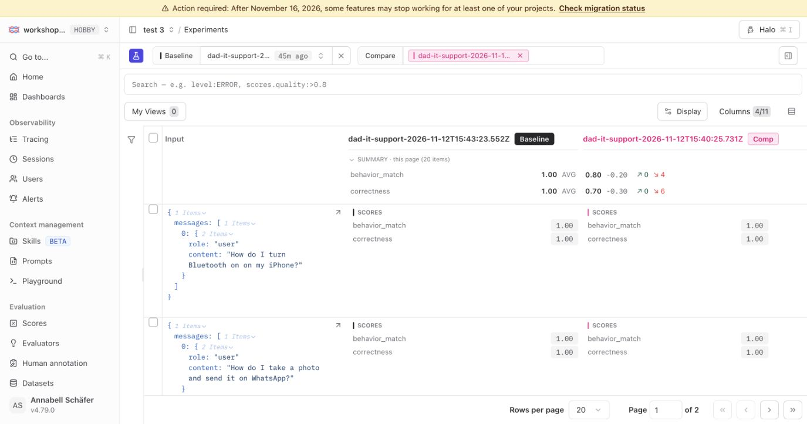

# 07 Evaluate a change

## Why evaluate changes with experiments

If you change anything about your AI app, a prompt, a model, the context you pass, even the agent architecture, you want to know whether the change actually made the system better. Eyeballing one or two outputs feels good but doesn't generalize. Rerunning the same dataset against the new version and comparing scores against the old run is the closest thing to a measurement.

This is also what lets you close the loop and **ship with confidence**: when the new run's averages go up (and you read enough individual items to be sure the score reflects reality), you have evidence to deploy the change.

Complementary materials:

- Docs: [Evaluation overview](https://langfuse.com/docs/evaluation/overview)
- Academy: [Evaluate](https://langfuse.com/academy/evaluate)

## Starting point

```bash
git checkout checkpoint/07-evaluation
```

Your app is traced, monitored, has a hosted dataset, and at least one experiment run with `behavior_match` and `correctness` scores. That run is your **baseline experiment**: it used the production `dad-it-support-agent` prompt, the same one whose traces you reviewed in [4.1 Error analysis](./04-monitoring/error-analysis.md). Now you swap in the more specific prompt that error analysis suggested and rerun the experiment to see whether it helped or hurt.

Look at your baseline run before making changes. Open the dataset → **Experiments** tab and check the averages:

- `correctness` average: what fraction of items did the judge mark as actually correct?
- `behavior_match` average: how often did Specs reply, defer, or ask a follow-up when the dataset expected it to?

Open the items where either score is low and read the agent's answer. A typical finding at this stage: the agent walks Dad through an out-of-scope request instead of deferring, answers a vague request without asking what is wrong, or gives generic advice instead of the iPhone-specific instructions. Whatever you see is the *problem you're about to try to fix*.

## What you could change

This chapter is framed around prompt iteration because changing the prompt is the lowest-friction lever. The same workflow applies if you change:

- **The model**: try a stronger or cheaper one and rerun.
- **The context**: add or remove fields from the system prompt or tool results.
- **The agent architecture**: add a tool, change tool ordering, change retries.
- **The prompt**: what we'll do here.

The shape is always the same: change *one* thing (or a configuration of multiple variables), rerun the dataset, compare runs side by side.

## Goal

Publish the prompt suggested at the end of error analysis and improve the experiment results: measured by `behavior_match` going up across the dataset compared with the baseline, without `correctness` going down.


Three passes:

1. **Change one thing**: publish the error-analysis prompt as a new version.
2. **Rerun the dataset** against the new prompt.
3. **Compare runs** side by side and decide whether to ship.

## Step 1: Change the prompt

Error analysis ended with a more specific prompt. Its Rules section answers the failure categories you found there, and the same rules address what the baseline run shows:

- **Out of scope:** "If he asks for something other than IT help, say so briefly, point him back to his phone, and ask one short redirect question. Do not answer that request." This targets the `defer_question` items, where the baseline agent walks Dad through a cake recipe or his savings, or answers a pasta question that comes up after a Bluetooth fix.
- **Vague requests:** "If you can't tell what he needs, ask one short clarifying question before giving any steps." This targets the `ask_follow_up` items, where the baseline agent answers "My phone is not working." with steps right away.
- **Lengthy responses and impersonation:** use short numbered lists for in-scope instructions, and make sure the agent speaks as the support agent, not as family. Brief refusals and clarifying questions can use prose instead of a numbered list. Neither has an evaluator in this workshop, so read a few answers to check them.

Two ways to make the change:

**Option A: Langfuse-side (create a new version in the UI, recommended):**

Prompts → `dad-it-support-agent` → create a new version or draft → replace the text with the prompt from the end of [4.1 Error analysis](./04-monitoring/error-analysis.md) → save that version → promote the new version to the `production` label. The resolver fetches by label, so the next request picks up the new version automatically. This is the workflow your team will use for ongoing iteration in production.

The prompt to paste:

```text
You are Dad IT Support Agent.
You are talking to Dad. He opened this chat himself to get help with his iPhone.

Look up which iPhone and apps he has, and search the help library, so the steps match his phone. Then tell him what to do: what to tap, and what he should see on the screen.

Use plain language.

Rules:
- Keep the reply to a short numbered list.
- If he asks for something other than IT help, say so briefly, point him back to his phone, and ask one short redirect question. Do not answer that request.
- If you can't tell what he needs, ask one short clarifying question before giving any steps.
- Use clear instructions on what to tap
- You are the support agent. Do not speak as someone in his family.
```

**Option B: Code-side (publish the bundled variant):**

The same prompt ships as the `error-analysis` variant in `scripts/publish-prompt.ts`:

```bash
WORKSHOP_PROMPT_VARIANT=error-analysis npm run prompt:publish
```

Either way you end up with a new prompt version, and the next `runSupportConversation(...)` call uses it.

## Step 2: Rerun the dataset

```bash
npm run dataset:run
```

You now have two runs under the same dataset: the baseline and the error-analysis prompt, each linked to its prompt version. The same `behavior_match` and `correctness` callback evaluators from step 06 score the new run automatically inside `runExperiment`.

## Step 3: Compare

In Langfuse:

- Dataset → **Experiments** tab → both rows visible with `behavior_match` and `correctness` averages.
- **Chart view** → per-run averages side by side.
- Add the new run as 'Compare with' in the sidebar



Things to look for:

- Which items improved (intentional).
- Which items regressed (the part that makes evaluation feel useful). Check `correctness` first: it is the regression check, so a drop there means the new prompt made an answer worse even if `behavior_match` went up.
- Whether the prompt change shifted scope (more refusals? more confident answers? more steps per response?).

For reference, test runs of this exact comparison on the 25-item dataset went from `behavior_match` 0.68–0.72 to 1.00 and `correctness` 0.68 to 0.84. Scores move between runs, so read the items that changed rather than trusting the averages alone.

## How to verify you are done

- Two runs appear under the dataset, linked to different prompt versions.
- Both scores (`behavior_match`, `correctness`) have averages you can compare.
- The console summary from `npm run dataset:run` already lists both scores for the new run.

## Wrap-up

Closing the loop, change → rerun → compare → decide, is what makes prompt or model changes go from gut calls to engineering decisions. Every future change has a free baseline to measure against.

The dataset and evaluators you compared with today are a starting point. When error analysis turns up a new failure, add items for it and, if it is worth tracking, an evaluator, then rerun the baseline so later comparisons include it.

The [**Langfuse skill**](https://github.com/langfuse/skills) (`/langfuse`) bumps prompt versions, links runs to versions, and produces a comparison chart automatically: this walkthrough exists so you see what the skill is doing under the hood.

## End state

This is the starting point for `08-wrap-up`.
